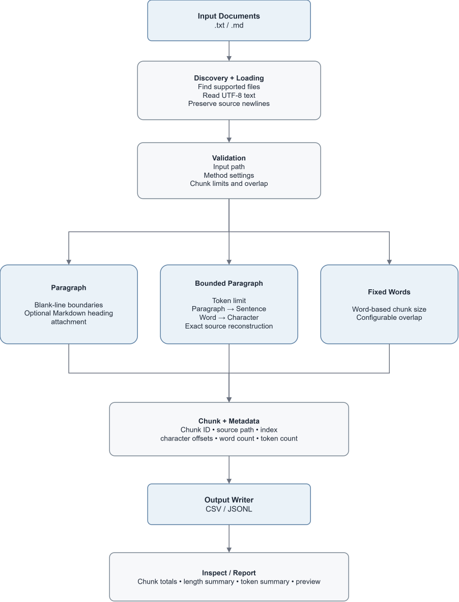

# Document Chunking Utility

The Document Chunking Utility is a CLI tool that splits text and Markdown documents into smaller, organized chunks with useful metadata.

The tool prepares local `.txt` and `.md` files for later natural language processing tasks. It splits documents into structured chunks that can still be traced back to their original source files. The utility supports paragraph-based chunking, bounded paragraph chunking with token limits, and fixed-size word chunking with overlap.

It also supports attaching short Markdown headings to the content that follows them, storing exact character offsets, rebuilding full source documents from bounded paragraph chunks, and creating chunk IDs based on the chunking configuration. The results can be exported as CSV or JSONL files. The utility also includes output inspection, run-level reports, a demonstration notebook, and automated tests.

## Table of Contents

* [Overview](#overview)
* [Motivation](#motivation)
* [Features](#features)
* [Architecture](#architecture)
* [Installation](#installation)
* [CLI Usage](#cli-usage)
* [Examples](#examples)
* [Output Schema](#output-schema)
* [Exact Offset and Reconstruction Behavior](#exact-offset-and-reconstruction-behavior)
* [Inspecting Outputs](#inspecting-outputs)
* [Demo Notebook](#demo-notebook)
* [Testing](#testing)
* [Software Design](#software-design)
* [Repository Structure](#repository-structure)
* [Validation and Error Handling](#validation-and-error-handling)
* [Limitations](#limitations)

## Overview

The Document Chunking Utility converts a folder of local text documents into a structured dataset of chunks. Each chunk contains useful information from the original document. This includes the source filename, source path, chunk index, character offsets, word count, character count, chunking method, and chunking settings.

Each chunk also gets a deterministic `chunk_id`. The chunk ID depends on the source file, chunking method, related settings, and the zero-based chunk index. This helps make sure that chunks created from the same source file do not get the same ID when different chunking methods or settings are used.

For bounded paragraph chunking, the output also stores token information. This includes the token count, maximum token limit, and tokenizer name.

For Markdown files, paragraph-based methods attach short headings to the content that comes after them. This prevents small heading-only chunks from being created and makes the chunks more useful for retrieval tasks.

The tool also keeps exact character offsets for each generated chunk. By using `start_char` and `end_char`, the exact `chunk_text` can be taken from the original source document.

For bounded paragraph chunking, the chunks are also kept continuous across the whole source document. This means the original document can be rebuilt by joining the bounded paragraph `chunk_text` values in the correct chunk order.

The output can be saved as either:

* `.csv` for spreadsheet-style review and data analysis
* `.jsonl` for use in pipelines and later NLP workflows

The tool is useful for preparing small text collections for:

* retrieval experiments
* retrieval-augmented generation preparation
* summarization input preparation
* classification datasets
* corpus review
* document preprocessing demos

## Motivation

Many NLP systems need documents to be divided into smaller sections before the text can be searched, summarized, classified, converted into embeddings, or sent to a language model.

However, simple text splitting can create several problems:

* information about the original source file may be lost
* the order of the chunks may become unclear
* chunks may be difficult to trace back to the original document
* character offsets may be missing or incorrect
* original whitespace may be removed during preprocessing
* exported chunks may not recreate the original source text exactly
* small Markdown headings may become separate chunks with little value for retrieval
* chunk IDs may be repeated when the same source file is processed using different methods or settings
* unsupported or empty files may affect the results without a clear warning
* experiments may be difficult to repeat, and output files may be difficult to check or reuse

## Features

* supports `.txt` and `.md` files
* reads text files using UTF-8 encoding
* keeps the original line endings, including CRLF line endings
* creates paragraph-based chunks using blank lines
* attaches short Markdown headings to the content that follows them
* creates bounded paragraph chunks with a configurable token limit
* keeps natural paragraphs together when they fit within the token limit
* splits large paragraphs using sentence, word, and character fallback methods
* keeps bounded paragraph chunks linked to exact sections of the original source
* allows the original source document to be rebuilt by joining bounded paragraph chunks in order
* creates fixed-size word chunks
* supports overlap between fixed-size chunks
* uses `tiktoken` to count tokens
* keeps the order of chunks consistent
* creates deterministic chunk IDs based on the chunking configuration
* stores exact character offsets
* keeps the source filename and source path
* includes word count and character count metadata
* includes token count metadata for bounded paragraph chunks
* exports results as CSV files
* exports results as JSONL files
* allows output files to be inspected from the CLI
* provides summary statistics for each run
* provides token-related summary statistics for bounded paragraph output
* checks for invalid paths, unsupported output formats, invalid chunk settings, invalid token limits, invalid tokenizer names, empty files, and file reading errors, and includes an automated `pytest` test suite

## Architecture

<p align="center">
  
</p>

## Installation

### Requirements

Use Python 3.10 or newer.

### 1. Enter the root directory

```bash
cd document-chunking-utility
```

### 2. Create a Virtual Environment

On macOS or Linux:

```bash
python -m venv .venv
```

```bash
source .venv/bin/activate
```

On Windows (Command Prompt):

```bat
python -m venv .venv
```

```bat
.venv\Scripts\activate
```

### 3. Install the Package

Install the package locally:

```bash
python -m pip install -e .
```

## CLI Usage

After installation, the CLI command is:

```bash
document-chunker
```

You can also run the package as a Python module:

```bash
python -m document_chunking_utility
```

### Show Help

```bash
document-chunker --help
```

Expected command overview:

```text
Usage: document-chunker [OPTIONS] COMMAND [ARGS]...

Split text and Markdown documents into metadata-rich chunks.

Commands:
  chunk    Chunk supported documents and write the results to a file.
  inspect  Inspect an exported CSV or JSONL chunk file.
```

### Chunk Command

```bash
document-chunker chunk [OPTIONS] INPUT_DIR
```

Arguments:

| Argument    | Description                                             |
| ----------- | ------------------------------------------------------- |
| `INPUT_DIR` | Directory containing `.txt` and `.md` source documents. |

Options:

| Option           | Description                                                   | Default              |
| ---------------- | ------------------------------------------------------------- | -------------------- |
| `--method`, `-m` | Chunking method: `paragraph`, `bounded-paragraph`, or `fixed` | `paragraph`          |
| `--out`, `-o`    | Output file path ending in `.csv` or `.jsonl`                 | `outputs/chunks.csv` |
| `--chunk-size`   | Number of words per fixed-size chunk                          | `200`                |
| `--overlap`      | Number of words shared between fixed-size chunks              | `40`                 |
| `--max-tokens`   | Maximum tokens per bounded paragraph chunk                    | `512`                |
| `--tokenizer`    | Tokenizer encoding used for bounded paragraph chunks          | `cl100k_base`        |

### Inspect Command

```bash
document-chunker inspect [OPTIONS] OUTPUT_FILE
```

Arguments:

| Argument      | Description                                  |
| ------------- | -------------------------------------------- |
| `OUTPUT_FILE` | Existing CSV or JSONL chunk file to inspect. |

Options:

| Option          | Description                         | Default |
| --------------- | ----------------------------------- | ------- |
| `--limit`, `-n` | Number of chunk previews to display | `5`     |

## Examples

The repository includes sample source documents in:

```text
examples/sample_docs/
```

Generated sample outputs are written to:

```text
examples/sample_outputs/
```

### Example 1: Paragraph Chunking to CSV

```bash
document-chunker chunk examples/sample_docs \
  --method paragraph \
  --out examples/sample_outputs/paragraph_chunks.csv
```

Equivalent module command:

```bash
python -m document_chunking_utility chunk examples/sample_docs \
  --method paragraph \
  --out examples/sample_outputs/paragraph_chunks.csv
```

Example output:

```text
Input directory: examples/sample_docs
Method: paragraph

Processed files: 2
Unsupported files skipped: 0
Empty files skipped: 0
Total chunks: 7
Average words per chunk: 25.6
Shortest chunk: 3 words
Longest chunk: 37 words
Output file: examples/sample_outputs/paragraph_chunks.csv
```

This command reads all supported files in `examples/sample_docs`, splits them on blank-line paragraph boundaries, attaches short isolated Markdown headings to the following content, and writes the resulting chunk records to a CSV file.

### Example 2: Fixed-Size Chunking with Overlap to CSV

```bash
document-chunker chunk examples/sample_docs \
  --method fixed \
  --chunk-size 40 \
  --overlap 5 \
  --out examples/sample_outputs/fixed_overlap_chunks.csv
```

Equivalent module command:

```bash
python -m document_chunking_utility chunk examples/sample_docs \
  --method fixed \
  --chunk-size 40 \
  --overlap 5 \
  --out examples/sample_outputs/fixed_overlap_chunks.csv
```

Example output:

```text
Input directory: examples/sample_docs
Method: fixed
Chunk size: 40
Overlap: 5

Processed files: 2
Unsupported files skipped: 0
Empty files skipped: 0
Total chunks: 6
Average words per chunk: 33.2
Shortest chunk: 19 words
Longest chunk: 40 words
Output file: examples/sample_outputs/fixed_overlap_chunks.csv
```

This command creates fixed-size chunks of up to 40 words. Each chunk after the first shares 5 words with the previous chunk.

### Example 3: Bounded Paragraph Chunking to CSV

```bash
document-chunker chunk examples/sample_docs \
  --method bounded-paragraph \
  --max-tokens 80 \
  --tokenizer cl100k_base \
  --out examples/sample_outputs/bounded_paragraph_chunks.csv
```

Equivalent module command:

```bash
python -m document_chunking_utility chunk examples/sample_docs \
  --method bounded-paragraph \
  --max-tokens 80 \
  --tokenizer cl100k_base \
  --out examples/sample_outputs/bounded_paragraph_chunks.csv
```

Example output:

```text
Input directory: examples/sample_docs
Method: bounded-paragraph
Maximum tokens: 80
Tokenizer: cl100k_base

Processed files: 2
Unsupported files skipped: 0
Empty files skipped: 0
Total chunks: 7
Average words per chunk: 25.6
Shortest chunk: 3 words
Longest chunk: 37 words
Tokenized chunks: 7
Average tokens per chunk: 30.1
Shortest token count: 5 tokens
Longest token count: 43 tokens
Output file: examples/sample_outputs/bounded_paragraph_chunks.csv
```

This command keeps paragraphs intact when possible, attaches short isolated Markdown headings to the following content, and splits any paragraph that exceeds the configured token limit.

Bounded paragraph chunks preserve exact source slices. Some bounded chunks may include blank-line spacing or nearby whitespace so the original document can be rebuilt by joining the bounded chunk text values in order.

### Example 4: Inspect a Bounded Paragraph Output File

```bash
document-chunker inspect examples/sample_outputs/bounded_paragraph_chunks.csv --limit 2
```

Equivalent module command:

```bash
python -m document_chunking_utility inspect examples/sample_outputs/bounded_paragraph_chunks.csv --limit 2
```

Example output:

```text
Output file: examples/sample_outputs/bounded_paragraph_chunks.csv
Format: CSV
Total chunks: 7
Source files: 2
Methods: bounded-paragraph
Average words per chunk: 25.6
Shortest chunk: 3 words
Longest chunk: 37 words
Tokenized chunks: 7
Average tokens per chunk: 30.1
Shortest token count: 5 tokens
Longest token count: 43 tokens

Preview records: 2
[0] campus_garden_notes_txt_fe25b38b_bounded_paragraph_mt80_tk_cl100k_base_000 | campus_garden_notes.txt | 3 words | 5 tokens | Campus Garden Notes
[1] campus_garden_notes_txt_fe25b38b_bounded_paragraph_mt80_tk_cl100k_base_001 | campus_garden_notes.txt | 33 words | 36 tokens | The campus garden looks different in the morning because the east side gets s...
```

### Example 5: Inspect a CSV Output File

```bash
document-chunker inspect examples/sample_outputs/paragraph_chunks.csv --limit 3
```

Example output:

```text
Output file: examples/sample_outputs/paragraph_chunks.csv
Format: CSV
Total chunks: 7
Source files: 2
Methods: paragraph
Average words per chunk: 25.6
Shortest chunk: 3 words
Longest chunk: 37 words

Preview records: 3
[0] campus_garden_notes_txt_fe25b38b_paragraph_000 | campus_garden_notes.txt | 3 words | Campus Garden Notes
[1] campus_garden_notes_txt_fe25b38b_paragraph_001 | campus_garden_notes.txt | 33 words | The campus garden looks different in the morning because the east side gets s...
[2] campus_garden_notes_txt_fe25b38b_paragraph_002 | campus_garden_notes.txt | 26 words | The student volunteers watered the raised beds after lunch. One group also pu...
```

### Example 6: JSONL Export

The same chunking commands can write JSONL output by changing the output file extension to `.jsonl`.

```bash
document-chunker chunk examples/sample_docs \
  --method bounded-paragraph \
  --max-tokens 80 \
  --tokenizer cl100k_base \
  --out examples/sample_outputs/bounded_paragraph_chunks.jsonl
```

The JSONL output stores one JSON object per chunk, which is useful for pipeline-style processing.

## Output Schema

Each generated chunk is written as either one row in a CSV file or one object in a JSONL file.

| Field         | Type            | Description                                                                               |
| ------------- | --------------- | ----------------------------------------------------------------------------------------- |
| `chunk_id`    | string          | A consistent ID based on the source file, chunking method, settings, and chunk index.                               |
| `source_file` | string          | Name of the original source file.                                                         |
| `source_path` | string          | Path to the source file relative to the input directory.                       |
| `method`      | string          | Chunking method used: `paragraph`, `bounded-paragraph`, or `fixed`.                       |
| `chunk_size`  | integer or null | Fixed chunk size used for fixed-size chunking. Blank/null for other methods.              |
| `overlap`     | integer or null | Word overlap used for fixed-size chunking. Blank/null for other methods.                  |
| `token_count` | integer or null | Token count for bounded paragraph chunks. Blank/null for paragraph and fixed-size chunks. |
| `max_tokens`  | integer or null | Maximum token limit used for bounded paragraph chunks. Blank/null for other methods.      |
| `tokenizer`   | string or null  | Tokenizer encoding used for bounded paragraph chunks. Blank/null for other methods.       |
| `chunk_index` | integer         | Zero-based chunk position within the source document.                                     |
| `chunk_text`  | string          | Text content of the chunk.                                                                |
| `start_char`  | integer         | Inclusive starting character offset in the original document.                             |
| `end_char`    | integer         | Exclusive ending character offset in the original document.                               |
| `char_count`  | integer         | Number of characters in the chunk.                                                        |
| `word_count`  | integer         | Approximate number of whitespace-delimited words in the chunk.                            |

The `chunk_id` includes the normalized source path slug, a short hash of the source path, the chunking method/settings, and the zero-padded chunk index.

Examples:

```text
campus_garden_notes_txt_fe25b38b_paragraph_000
campus_garden_notes_txt_fe25b38b_fixed_cs40_ov5_000
campus_garden_notes_txt_fe25b38b_bounded_paragraph_mt80_tk_cl100k_base_000
```

This makes chunk IDs safer when the same source file is chunked multiple ways.

### Example JSONL Record

```json
{
  "chunk_id": "campus_garden_notes_txt_fe25b38b_bounded_paragraph_mt80_tk_cl100k_base_000",
  "source_file": "campus_garden_notes.txt",
  "source_path": "campus_garden_notes.txt",
  "method": "bounded-paragraph",
  "chunk_size": null,
  "overlap": null,
  "token_count": 5,
  "max_tokens": 80,
  "tokenizer": "cl100k_base",
  "chunk_index": 0,
  "chunk_text": "Campus Garden Notes",
  "start_char": 0,
  "end_char": 19,
  "char_count": 19,
  "word_count": 3
}
```

## Exact Offset and Reconstruction Behavior

The utility stores character offsets so each chunk can be traced back to the original document.

For any generated chunk, this relationship should hold:

```python
source_text[chunk.start_char:chunk.end_char] == chunk.chunk_text
```

The same rule applies after metadata construction and export:

```python
source_text[record["start_char"]:record["end_char"]] == record["chunk_text"]
```

For bounded paragraph chunks, the utility also preserves full document reconstruction. When bounded paragraph chunks are ordered by `chunk_index`, joining their text should rebuild the original document exactly:

```python
rebuilt_text = ""

for chunk in chunks:
    rebuilt_text += chunk.chunk_text

assert rebuilt_text == source_text
```

This is why bounded paragraph chunks may contain blank lines or extra whitespace around the text. This whitespace is part of the original source document, so it is kept to make sure the character offsets and document reconstruction stay exact.

The loader also keeps the original line endings from the file, including CRLF (`\r\n`) line endings. This means the character offsets are calculated using the exact text stored in the source file.

The reconstruction check is tested at three levels:

* bounded paragraph chunk objects,
* metadata records created from bounded paragraph chunks,
* and exported bounded paragraph records in CSV and JSONL files.

## Inspecting Outputs

The `inspect` command is useful for quickly checking generated outputs.

It reports:

* output file path
* file format
* total chunks
* number of source files
* chunking methods present
* average words per chunk
* shortest chunk length
* longest chunk length
* token statistics when token metadata is available
* preview records

Example:

```bash
document-chunker inspect examples/sample_outputs/fixed_overlap_chunks.csv --limit 5
```

Use `--limit 0` to show only summary statistics:

```bash
document-chunker inspect examples/sample_outputs/fixed_overlap_chunks.csv --limit 0
```

For bounded paragraph outputs, inspection also reports token statistics:

```bash
document-chunker inspect examples/sample_outputs/bounded_paragraph_chunks.csv --limit 2
```

## Demo Notebook

The repository includes a demonstration notebook:

```text
notebooks/demo_document_chunking.ipynb
```

The notebook provides a walkthrough of the utility workflow using the sample documents and generated outputs. It covers paragraph chunking, bounded paragraph splitting, fixed-size overlap behavior, metadata inspection, exact offset reconstruction, and bounded paragraph source reconstruction.

Run the notebook to create and review the demonstration outputs.

Install the optional notebook dependencies before running it again:

```bash
python -m pip install -e ".[demo]"
```

Then start Jupyter:

```bash
python -m jupyter notebook
```

## Testing

Install the development dependencies:

```bash
python -m pip install -e ".[dev]"
```

Run the full test suite with:

```bash
pytest
```

Verified result:

```text
224 passed
```

The tests cover:

* paragraph chunking behavior
* Markdown heading attachment behavior
* bounded paragraph chunking behavior
* checking that bounded paragraph offsets match the original text
* rebuilding the full source document from bounded paragraph chunks
* token-aware paragraph splitting
* tokenizer loading and token counting
* fixed-size chunking behavior
* fixed-size overlap behavior
* deterministic chunk ordering
* consistent chunk ID construction based on the chunking settings
* character offset correctness
* metadata field generation
* token metadata generation
* CSV export
* JSONL export
* rebuilding bounded paragraph output after export
* output reloading
* empty file handling
* unsupported file handling
* invalid UTF-8/read-error handling
* source line-ending preservation during loading
* validation errors
* CLI behavior
* inspect command behavior
* token-aware inspect behavior
* summary report generation
* token-aware summary report generation
* portable path formatting

## Software Design

### Determinism

The utility is designed to produce consistent results when it is run with the same input files and settings.

Determinism is supported by:

* consistent recursive file discovery
* consistent chunk ordering
* deterministic chunk IDs based on the chunking configuration
* predictable metadata generation
* exact character offsets based on the source text
* clearly defined chunking settings
* clearly defined tokenizer settings for bounded paragraph chunking
* repeatable CSV and JSONL output formats

### Traceability

Each chunk stores enough metadata to trace it back to the original source document.

Traceability fields include:

* `source_file`
* `source_path`
* `chunk_index`
* `start_char`
* `end_char`
* `chunk_id`

The `chunk_id` is based on the source identity, chunking method, related chunking settings, and chunk index. This helps keep chunks different when the same source document is processed using different methods or settings.

For bounded paragraph chunks, extra token information is also stored:

* `token_count`
* `max_tokens`
* `tokenizer`

The `start_char` and `end_char` values are calculated using the original document text. This allows each chunk to be linked back to its exact location in the source file.

Bounded paragraph chunks are also designed so that the full source document can be rebuilt by joining their `chunk_text` values in the correct chunk order.

### Inspectability

The utility is designed so that its outputs are easy to check both manually and through code.

CSV files can be opened in spreadsheet programs or loaded into pandas.

JSONL files can be read one line at a time or loaded into data processing pipelines.

The `inspect` command provides a quick way to check generated output files from the CLI. For bounded paragraph outputs, it also shows token-based summary statistics and includes token counts in the preview records.

### Modularity

The implementation uses a small package structure with separate modules for each major responsibility.

| Module          | Responsibility                                                                                 |
| --------------- | ---------------------------------------------------------------------------------------------- |
| `cli.py`        | Defines the CLI interface and user-facing commands.                                            |
| `chunkers.py`   | Implements paragraph, bounded paragraph, fixed-size chunking, and Markdown heading attachment. |
| `io.py`         | Handles document discovery, reading, and output writing.                                       |
| `metadata.py`   | Builds chunk records, configuration-aware chunk IDs, offsets, counts, and token fields.        |
| `paths.py`      | Normalizes paths into portable metadata strings.                                               |
| `report.py`     | Computes and formats run-level word and token summaries.                                       |
| `tokenizer.py`  | Loads tokenizer encodings and counts tokens.                                                   |
| `validation.py` | Validates paths, file types, chunking settings, token limits, and output settings.             |

## Repository Structure

```text
document-chunking-utility/
  src/document_chunking_utility/   # source code
  tests/                           # pytest suite
  examples/sample_docs/            # sample input documents
  examples/sample_outputs/         # generated example outputs
  notebooks/                       # demo notebook
  README.md
  pyproject.toml
```

## Validation and Error Handling

The utility validates common error cases before or during processing.

Handled cases include:

* input path does not exist
* input path is not a directory
* output file extension is not `.csv` or `.jsonl`
* unsupported input file extensions
* empty supported files
* whitespace-only supported files
* unreadable or malformed UTF-8 files
* invalid chunking method
* invalid chunk size
* invalid overlap
* overlap greater than or equal to chunk size
* invalid maximum token limit
* empty tokenizer name
* unknown tokenizer encoding
* invalid inspect path
* invalid inspect preview limit
* malformed JSONL during inspection

Unsupported files, empty files, and read-error files are skipped and reported in the run summary.

## Limitations

* only `.txt` and `.md` files are supported
* Markdown is mostly treated as plain readable text
* short isolated Markdown headings are attached to following content, but Markdown structure is not fully semantically parsed
* PDF files are not supported
* OCR is not supported
* chunking is rule-based, not model-based
* plain paragraph chunks may vary significantly in length
* fixed-size chunks may split coherent context
* bounded paragraph chunking uses simple sentence, word, and character fallback rules
* bounded paragraph chunks may include source whitespace so full document reconstruction remains exact
* token counts depend on the selected tokenizer encoding
* overlap can increase duplicate text across chunks
* the utility does not determine the best chunking strategy for a downstream task
* the utility does not perform retrieval, ranking, embedding, summarization, or generation